# DS Flow Visualizer | Algorithmic Execution & State Machine Canvas

[](https://flask.palletsprojects.com/)
[](flow_state.json)
[](templates/)
[](app.py)

> **Executive Overview**: Interactive algorithmic state visualizer translating abstract memory graphs, sorting passes, and tree balancing operations into deterministic step-by-step state machine flows.

---

## 1. Engineering Narrative: Problem, Architecture & Outcome

### Problem Bottleneck
Complex data structures and recursive algorithms (e.g., AVL tree rotations, Dijkstra graph sweeps, quicksort partition boundaries) are inherently difficult to analyze, teach, and optimize without synchronized memory state inspection. Standard print statements fail to communicate structural state evolution.

### Architectural Decision
Constructed a decoupled state execution visualizer. The Flask backend (`app.py`) executes algorithms and records memory mutations into a structured JSON transition log (`flow_state.json`). The web frontend renders these state deltas as an animated, interactive canvas with forward/backward scrubbing controls.

### Quantifiable Engineering Outcome
- **Zero Jitter**: Continuous 60 FPS animation loop with smooth micro-transitions.
- **Deterministic Replay**: 100% reproducible step-by-step traversal for complex graph and tree operations.
- **Lightweight Runtime**: Zero client-side bundle weight using native HTML5 Canvas and CSS transitions.

---

## 2. System Architecture: C4 Component & State Flow

```mermaid
flowchart LR
    subgraph BACKEND_ENGINE ["Algorithm State Recorder (Flask 3.0)"]
        INPUT["Algorithm Input Parameters"] --> APP["Flask Controller (app.py)"]
        APP --> RUNNER["Algorithm Execution Engine"]
        RUNNER -->|"Snapshot Mutation"| RECORDER["State Recorder"]
        RECORDER --> STATE_JSON[("State Log (flow_state.json)")]
    end

    subgraph FRONTEND_CANVAS ["Interactive State Canvas"]
        STATE_JSON --> CLIENT["Web Visualizer (templates/)"]
        CLIENT --> SCRUBBER["Timeline Scrubber Controller"]
        SCRUBBER --> RENDERER["HTML5 Canvas / SVG Graph Renderer"]
    end

    style BACKEND_ENGINE fill:#090A0F,stroke:#06B6D4,stroke-width:1px
    style FRONTEND_CANVAS fill:#11131C,stroke:#10B981,stroke-width:1.5px
```



---

## 3. Core Module & Source Manifest

| File / Module | Responsibility | Invariant / Performance Target |
|---|---|---|
| `app.py` | Flask application server serving endpoints and algorithmic transitions | Sub-10ms snapshot recording |
| `flow_state.json` | Deterministic array of state frames (pointers, values, memory nodes) | Strict JSON schema format |
| `templates/` | HTML5 canvas templates with timeline scrubber UI | Responsive across viewport widths |
| `requirements.txt` | Minimal pinned Python dependencies | Lean deployment |

---

## 4. Reproducible Quickstart

### Setup & Launch
```bash
# 1. Enter Directory
cd "C:/Users/sridh/Desktop/ds app/flow_visualizer"

# 2. Configure Environment
cp .env.example .env

# 3. Install Requirements & Run
pip install -r requirements.txt
python app.py
```
Visit `http://localhost:5000` to interact with the visualizer.
